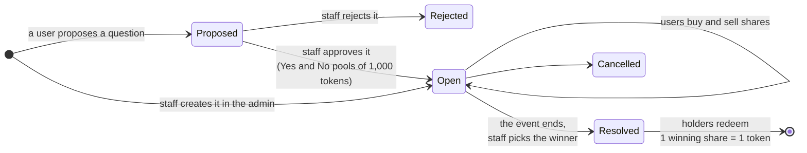
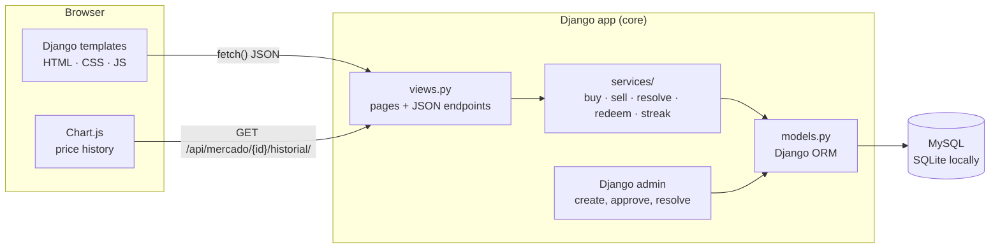
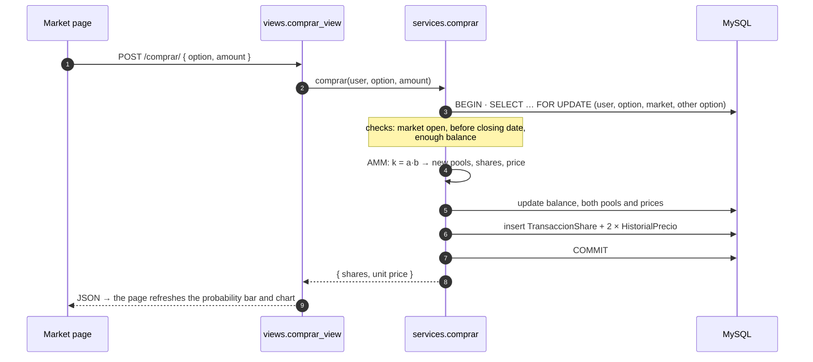
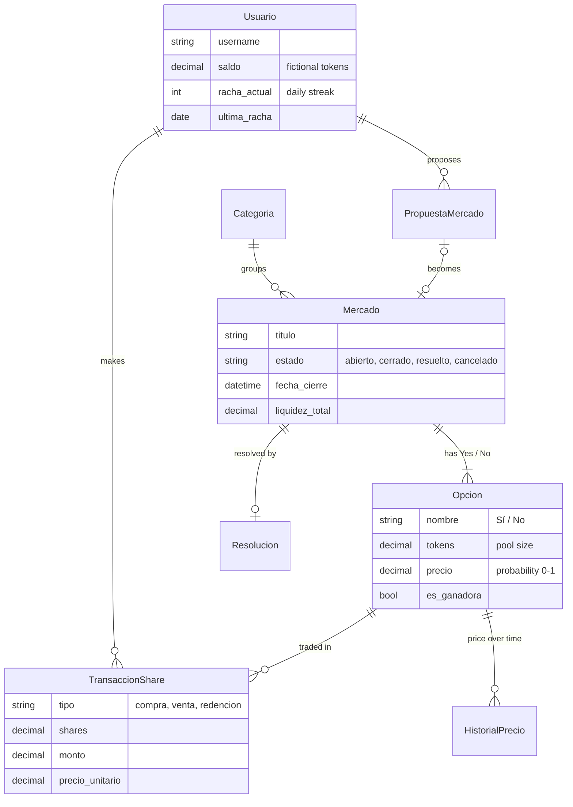

<div align="center">

# PolyBuxef

**Prediction markets for the Beauchef community, played with fictional tokens.**

Inspired by Polymarket: students predict the outcome of campus events such as the *Copa de la Mona*,
and every trade moves the probability in real time through an automated market maker.


-003B57?logo=sqlite&logoColor=white)


[**▶ Try the interactive demo**](https://cesarbarrueto0409.github.io/#demo-polybeauchef) ·
[How a market works](#how-a-market-works) ·
[Architecture](#architecture) ·
[Run it locally](#run-it-locally)



</div>

---

## In 30 seconds

- **What it is:** a web app where the community creates Yes/No questions about campus events and everyone takes a position with fictional tokens. The market price is the community's estimated probability.
- **How prices move:** a **constant-product automated market maker** (`k = Yes × No`), the same idea used by decentralized exchanges. No order book and no counterparty needed.
- **What it shows:** a full Django application with a service layer, atomic database transactions with row locks, a market lifecycle, user accounts, daily rewards, rankings and community-proposed markets.
- **No real money:** tokens are fictional, have no value and cannot be bought or withdrawn. They only feed the community ranking.

> Team project for a software engineering course at the Department of Computer Science (DCC), Universidad de Chile.

---

## How a market works

### 1. The life of a market



### 2. The pricing rule

Each market has two pools of tokens, one per option. Their product stays constant on every trade:

$$k = \text{Yes pool} \times \text{No pool}$$

The probability of an option is the share of tokens on the **other** side:

$$P(\text{Yes}) = \frac{\text{No pool}}{\text{Yes pool} + \text{No pool}}$$

**Buying Yes with `m` tokens** (from `comprar()` in `core/services/__init__.py`):

| Step | Formula | Example (pools 1,000 / 1,000, m = 100) |
|---|---|---|
| Tokens go to the opposite pool | `No' = No + m` | 1,000 + 100 = **1,100** |
| The chosen pool shrinks to keep `k` | `Yes' = k / No'` | 1,000,000 / 1,100 = **909.1** |
| The buyer gets the difference as shares | `shares = Yes − Yes'` | 1,000 − 909.1 = **90.9 shares** |
| New probability | `No' / (Yes' + No')` | 1,100 / 2,009.1 = **54.8 %** |

Selling runs the same formula in reverse: the shares return to their pool and the user receives tokens from the other pool. The bigger a trade is compared to the pools, the more it moves the price, so large positions get progressively more expensive.

When the market is resolved, each winning share is redeemed for **1 token**.

### 3. What a user can do

| Feature | Details |
|---|---|
| **Account** | Sign up with Django auth; every new user starts with **1,000 fictional tokens** |
| **Markets** | Browse open markets, see the live probability and its price history chart |
| **Trade** | Buy or sell shares of Yes or No while the market is open and before its closing date |
| **Portfolio** | Positions per market, transaction history and redeemable winning shares |
| **Daily streak** | Claim tokens once a day: `min(consecutive days, 5) × 100` tokens; missing a day resets it |
| **Ranking** | Top 100 users by balance |
| **Propose a market** | Suggest a question; staff approves or rejects it from the Django admin |
| **Profiles** | Public profiles and user search |

---

## Architecture



Business rules live in a **service layer** (`core/services/`), not in the views. Views only parse the request, call a service and return HTML or JSON. That keeps the pricing logic in one place and easy to test.

### What happens when someone buys

Two people can trade the same market at the same moment. Every trade runs inside one **database transaction** and locks the rows it touches, so pools, balances and prices can never get out of sync.



### Data model



---

## Design decisions

<details>
<summary><b>Why a constant-product AMM instead of an order book</b></summary>

<br>

A small community has few traders, so an order book would often have nobody on the other side. With an AMM the market itself is always the counterparty: anyone can trade at any moment, and the price comes straight from the pools. It is also simple enough to explain on one screen, which matters for a community app.

</details>

<details>
<summary><b>Consistency under concurrency</b></summary>

<br>

`comprar`, `vender`, `redimir`, `resolver_mercado` and `canjear_racha_diaria` run inside `transaction.atomic()` and lock rows with `select_for_update()`. If two users buy the same option at the same time, the second waits for the first, then computes its price from the updated pools. All money-like fields use `Decimal`, never `float`, to avoid rounding drift.

</details>

<details>
<summary><b>Positions are computed from the transaction log</b></summary>

<br>

There is no separate "positions" table. A user's shares of an option are `purchases − sales − redemptions` summed from `TransaccionShare`. One source of truth means a position can never disagree with the history, and the full audit trail comes for free.

</details>

<details>
<summary><b>Daily streak rules</b></summary>

<br>

| Last claim | Result |
|---|---|
| Today | Already claimed, nothing to do |
| Yesterday | Streak + 1, reward `min(streak, 5) × 100` |
| Earlier or never | Streak resets to 1, reward 100 |

So the reward grows from 100 to a maximum of 500 tokens per day.

</details>

<details>
<summary><b>Staff tools in the Django admin</b></summary>

<br>

Instead of building a separate back office, staff work in the Django admin: they create markets and options, approve or reject proposals in bulk (approval creates the market with Yes/No pools of 1,000 tokens), and resolve markets. Resolving is also exposed as an endpoint restricted to `is_staff` users.

</details>

---

## Endpoints

<details>
<summary>Pages and JSON API (<code>core/urls.py</code>)</summary>

<br>

| Method | Route | Purpose |
|---|---|---|
| `GET` | `/` | Home: open markets and daily streak |
| `GET` | `/mercado/<id>/` | Market page with probability bar and price chart |
| `GET` | `/mercados/` | Markets as JSON |
| `GET` | `/api/mercado/<id>/` | One market with its options and prices |
| `GET` | `/api/mercado/<id>/historial/` | Price history for the chart |
| `POST` | `/comprar/` | Buy shares |
| `POST` | `/vender/` | Sell shares |
| `POST` | `/redimir/` | Redeem winning shares |
| `POST` | `/api/mercado/<id>/resolver/` | Resolve a market (staff only) |
| `POST` | `/api/racha/canjear/` | Claim the daily streak |
| `GET` | `/api/portafolio/<user>/` · `/api/historial/<user>/` | Positions and transactions |
| `GET` | `/ranking/` · `/api/ranking/` | Top 100 by balance |
| `GET/POST` | `/proponer/` · `/mis-propuestas/` | Propose markets and follow their status |
| `GET/POST` | `/registro/` · `/login/` · `/logout/` · `/perfil/` · `/perfiles/` | Accounts and profiles |

</details>

---

## Project structure

```text
polybuxef/
├── config/                 # Django settings (MySQL via .env, SQLite fallback), URLs
├── core/
│   ├── models.py           # Usuario, Mercado, Opcion, TransaccionShare, HistorialPrecio, …
│   ├── services/
│   │   ├── __init__.py     # AMM: comprar, vender, resolver_mercado, redimir, daily streak
│   │   ├── mercado_service.py, opcion_service.py, categoria_service.py
│   ├── views.py            # Pages and JSON endpoints
│   ├── admin.py            # Staff tools, proposal approval
│   ├── templates/          # Home, market, portfolio, ranking, profile, proposals
│   └── migrations/         # Includes initial categories
├── docs/amm.svg            # Animated diagram used in this README
├── manage.py
└── requirements.txt
```

---

## Run it locally

```bash
git clone https://github.com/cesarbarrueto0409/polybuxef.git
cd polybuxef
python -m venv .venv
.venv\Scripts\activate            # macOS/Linux: source .venv/bin/activate
pip install -r requirements.txt
python manage.py migrate
python manage.py createsuperuser  # staff account for the admin
python manage.py runserver
```

Open `http://127.0.0.1:8000/`, sign up, and create a market with Yes and No options from `http://127.0.0.1:8000/admin/`.

<details>
<summary>Use MySQL instead of SQLite</summary>

<br>

Without a `.env` file the app uses SQLite (`db.sqlite3`). For MySQL, copy the example and fill in your connection:

```bash
cp .env.example .env
```

```env
DB_CONNECTION=mysql
DB_HOST=127.0.0.1
DB_PORT=3306
DB_DATABASE=database_name
DB_USERNAME=database_user
DB_PASSWORD=database_password
```

Never commit `.env`.

</details>

---

## Roadmap

- [ ] Take the user from the session in every JSON endpoint and turn CSRF protection back on.
- [ ] Automated tests for the AMM (price always between 0 and 1, `k` constant, balances never negative).
- [ ] Markets with more than two options.
- [ ] Close markets automatically at their closing date.

---

<div align="center">

**Team:** [cesarbarrueto0409](https://github.com/cesarbarrueto0409) ·
[FPereiraI](https://github.com/FPereiraI) ·
[giarf](https://github.com/giarf) ·
[angelcastro819](https://github.com/angelcastro819) ·
[jensen-facts](https://github.com/jensen-facts)

Department of Computer Science · Universidad de Chile

</div>
